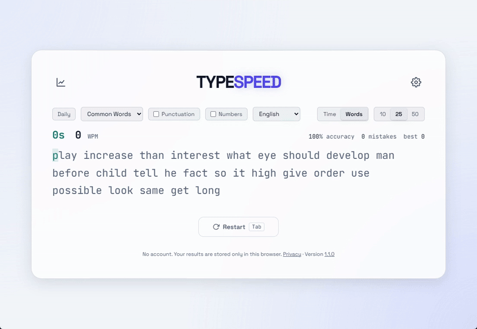
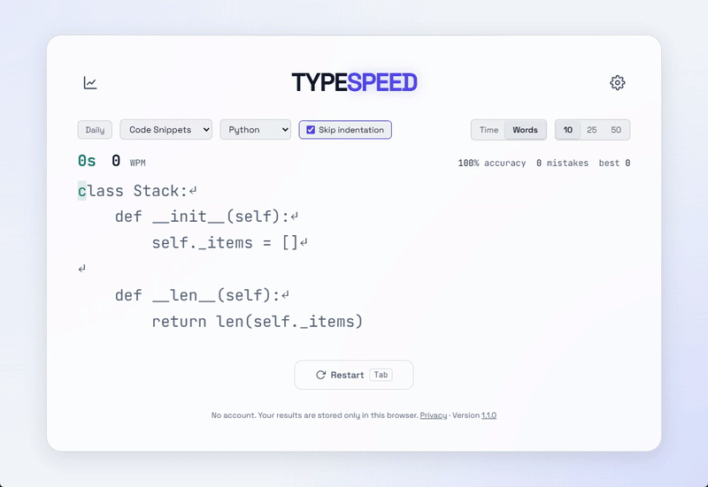
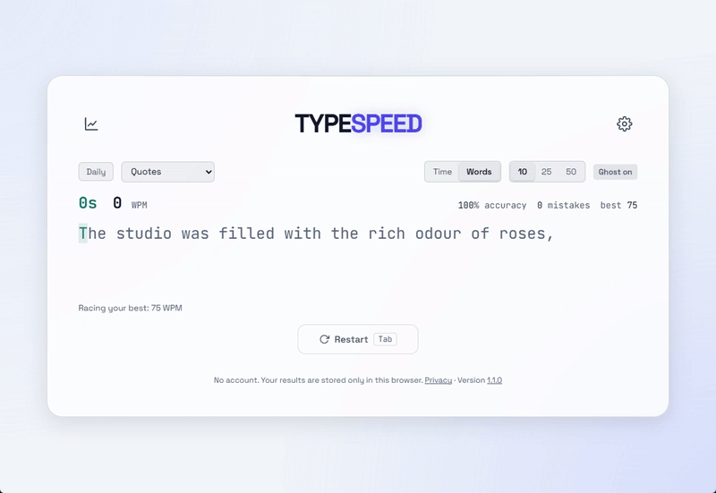

# TypeSpeed

A typing trainer that runs in the browser. Plain HTML, CSS, and JavaScript, no framework, no build step.

Live: https://tmhsdigital.github.io/Typing-Game/

- No account. Results are stored in your browser only, and the page makes no requests to other sites (see Privacy).
- Works offline after the first visit (see Offline and install).
- Code snippets in six languages, with leading indentation filled in for you (see Code Snippets).
- Ghost Mode replays your best run on the same passage while you type (see Ghost Mode).
- Challenge links carry a run in the URL, so a friend can race it without a server (see Challenge links).




## Run it

Serve the folder with `npm run serve` (see Development) or any static file server, and open it in a browser. Opening `index.html` directly from disk also works, but Chromium-based browsers block the fonts on `file://`, so system fonts are used there, and offline support is skipped. The page makes no requests to other sites. The fonts, JetBrains Mono, Space Grotesk, and OpenDyslexic, are served from `fonts/` under the SIL Open Font License (OpenDyslexic is downloaded only when it is picked as the passage font), and a Content-Security-Policy limits scripts, styles, and fonts to the site itself.

## What it does

- **Mode and length**: picked from the bar above the text. Changing them starts a new run.
- **Time mode**: type for 15, 30, or 60 seconds. When you finish a passage a new one loads until the clock runs out.
- **Words mode**: type a fixed 10, 25, or 50 words. The clock counts up.
- **Categories**:
  - Common Words (the default): 200 frequent English words in random order, never the same word twice in a row. The Punctuation and Numbers checkboxes next to the category menu add punctuation (capitalized sentences, commas, full stops) and numbers; they are shown only for Common Words. A menu next to them picks the language: English, or Spanish, French, or Portuguese, each the 200 most frequent words from FrequencyWords (word counts from OpenSubtitles), kept in `wordlists.js` with their accents. An accent typed with a dead key, which the browser reports as composition text before the accented letter replaces it, is not counted as a keystroke of its own. Each language has its own best scores.
  - Weak Keys: practice for the three keys you miss most often, by miss rate, among keys you have typed at least five times: letters, digits, and symbols, but not space or new line. Weak letters pick common words that contain them. Weak digits and symbols are added to about every other word: brackets and quotes around it, a digit as a two-digit number in its place, any other symbol after it. Until there is enough data it uses all common words.
  - Lessons: six stages for learning to touch type, picked with a menu next to the category: 1 Home row (a s d f g h j k l, with a list of home-row words in `texts.js`), 2 Top row (adds q to p), 3 Bottom row (all letters), 4 Capitals (about a third of the words capitalized), 5 Punctuation (commas, full stops, question marks, capitalized sentences), 6 Numbers. Each stage's text uses only its keys. A recorded run passes a stage at 95% accuracy and 20 WPM; passing unlocks the next stage, and the result dialog says so. Locked stages are shown, disabled, in the menu. Each stage has its own best scores, and a stage can be sent as a challenge link.
  - Books: six public-domain books, typed a page at a time: Alice's Adventures in Wonderland (Lewis Carroll), A Christmas Carol (Charles Dickens), The Time Machine (H. G. Wells), The Adventures of Sherlock Holmes (Arthur Conan Doyle), Frankenstein (Mary Shelley), and Pride and Prejudice (Jane Austen). A menu next to the category picks the book, and the note next to it shows the chapter and page. A run is one page of up to 700 characters, with Enter between paragraphs; mode and length do not apply. Finishing a page moves that book on to the next one, also after a reload, and the result dialog names the page; after the last page the book starts again. Each book is a file in `books/`, loaded from the site when it is picked. `scripts/build-books.mjs` makes these files from the Project Gutenberg plain-text editions, without their license header and footer: it splits chapters, cuts pages at sentence ends, and replaces characters a US keyboard does not have (curly quotes, dashes, accents). Books keep no best scores and cannot be sent as challenge links.
  - Quotes: 50 passages, most of them opening lines of public-domain books.
  - Technology: 50 quotes about programming and computing.
  - Code Snippets: snippets of 2 to 9 lines, at least 25 per language, in JavaScript, Python, Go, Rust, SQL, or Shell, picked with a second menu that appears next to the category. Enter types a new line, shown in the text as a return arrow. With Skip indentation on (the default, a checkbox next to the language menu), the leading spaces of each new line are filled in for you; they count toward neither WPM nor accuracy. In Words mode, whole snippets are used until there are at least that many words. Each language has its own best scores. Your code, the last entry in the language menu, types code you paste or load from a file in the dialog that Edit code opens: the file is read in the browser and not uploaded. Tabs become four spaces, trailing spaces and repeated blank lines are removed, lines over 100 characters are dropped, and code past 20,000 characters is cut at a line. Each passage is a block of up to 15 lines between blank lines, moved to the left margin. Each saved code has its own best scores, keyed by a hash of the code; it is not sent in challenge links. With no code saved, Your code uses JavaScript snippets.

    

  - Custom Text: text you paste into the dialog that Edit text, next to the category menu, opens. Curly quotes and dashes are converted to plain ones, line breaks become spaces, and text past 2000 characters is dropped. Words mode repeats the text from the start when it has fewer words than the word count. Each custom text has its own best score, keyed by a hash of the text. Custom Text runs cannot be sent as challenge links. With no text saved, Custom Text uses common words and records the runs as Common Words.

  When the source of a passage is known, the result dialog shows it. Passages are in `texts.js`.

- **Live stats**: WPM, accuracy, mistakes, and your best WPM for the current settings, updated as you type.
  - WPM is correct characters divided by five, per minute of real elapsed time.
  - Accuracy is the share of typed characters that matched, counting mistakes you later fixed. It is rounded down, so 100% means no mistakes.
- **Stop on error**: with this setting on, a wrong key is counted as a mistake but does not move the caret, so each mistake has to be fixed with the right key before you can continue.
- **Keyboard layout**: in Settings, Colemak, Colemak-DH, Dvorak, or Workman instead of QWERTY. The physical keys of a US keyboard then type that layout's letters and punctuation, whatever layout the operating system uses; Shift and Caps Lock work as usual, and shortcuts with Ctrl, Alt, or Cmd are not changed. Not offered on touch screens, whose on-screen keyboards cannot be remapped. Each layout has its own best scores and key stats, so Weak Keys and the Stats keyboard follow the layout in use.
- **Caps Lock warning**: a notice below the text while Caps Lock is on.
- **Hard Mode**: blurs the characters you have already typed, so you cannot see your mistakes. The text ahead stays readable.
- **Ghost Mode**: records the timing of your best run and replays its position as a second cursor while you type. Bests record the seed their passages were drawn from, so with Ghost Mode on you type the same passages as your best run. In Time mode, when the ghost is on a later or earlier passage than you, its cursor waits at the end or start of yours with an arrow pointing the way. A line below the text shows how many characters ahead of or behind the ghost you are, or says that no ghost exists yet for the current settings. In Weak Keys, a ghost run uses the letters the best run practiced, and the note above the text says so. Bests also record a hash of their first passage. If a change to `texts.js` means the seed no longer gives that passage, Ghost Mode says so and does not replay the best until a new best is set.

  

- **Pace caret**: a second cursor that moves at a steady speed: a target WPM you set (10 to 300), your average of the last ten runs at the current settings, or your last run at them. Character `n` is reached at `n × 12000 / WPM` milliseconds. The line below the text shows how many characters ahead of or behind it you are. It is set in Settings and is not shown while Ghost Mode is on or a challenge is played.
- **Results**: a modal titled with the run's length and category, with your WPM as the headline; accuracy, raw WPM (all typed characters, right or wrong), correct and wrong character counts, and elapsed time under it; whether the run set a new best for its settings, and the previous best; the keys you missed most in this run, and, once you have missed letters often enough, a link that starts a Weak Keys run; a line chart of raw WPM at the end of each second of the run; a line chart of your last ten runs at the current settings once you have three or more, both labeled with their lowest and highest value and the ends of their x axis; and a Share result button. The shared text has the WPM, accuracy, settings, and a link to the site. On touch devices it opens the system share sheet; elsewhere it copies to the clipboard.
- **Daily**: the Daily button, or the page opened with `#daily` at the end of its URL, starts the day's run: Time 30s, Common Words with punctuation, Stop on error off. The passages come from a seed that is the hash of `daily-` and the UTC date (`daily-2026-10-25`), so everyone who plays on the same UTC day types the same text. Days are numbered from 25 October 2026, Daily #1. The first run of a second or longer each day is the day's result; later runs that day are practice and are not stored as the daily. The result dialog and Share result give the day's result as a line and a grid with one square per 5 seconds: green at 95% accuracy or more, yellow at 85% or more, red below, white when nothing was typed. The text of the passage is not in the share. Your saved settings come back after the run, and pressing Daily again leaves it.
- **Result image**: Save image in the result dialog draws a 1200x630 PNG on a canvas, in the current theme's colors: the run's settings, WPM, accuracy, raw WPM, correct and wrong characters, time, the raw WPM chart, the date, and the site address. On touch devices that can share files, it opens the system share sheet with the image and the Share result text; elsewhere it downloads `typespeed-<date>.png`.
- **Replay**: Watch replay in the result dialog plays the run back at its recorded times, at 1x or 2x, with pause. It shows the text as it was after each input event, so wrong characters and corrections appear and disappear as they did. The replay is kept in memory for the last run only and is not stored.
- **Challenge links**: after a run of a second or longer, Copy challenge link puts a URL on the clipboard, or on touch devices opens the system share sheet. If copying fails, the link is shown, selected, in the result dialog. The URL's hash holds the run's settings, including Stop on error and Skip indentation, the seed of its passages, its WPM, and its keystroke timings, compressed. Opening it, also in a tab that already has the page open, starts a run on the same passages with that run as the ghost, and the result dialog says who was faster. The receiver's saved settings are not changed; after the run, Play again goes back to them. Links also carry a hash of the run's first passage. If a change to `texts.js` means the seed no longer gives that passage, the run is still played, but without a ghost, and the result dialog does not say who won. Links made before this hash was added are played without the check.
- **Stats dialog**: opened from the chart icon in the header, with the average of your last ten runs and, from two days on, how many days in a row you have practiced; a keyboard of the current layout shaded by how often you miss each key across all recorded runs, counting a character and its shifted one together, with keys under five attempts marked as not enough data; a chart of your daily average WPM at the current settings once there are two days of runs; your best WPM for every setting you have played; and a list of recorded runs. Export saves everything in `localStorage` to a JSON file, Import loads such a file and replaces the stored data, and Clear data (two clicks) removes history, bests, key stats, daily results, and lesson and book progress.
- **Themes**: System (follows the OS light/dark and increased-contrast settings), Dark, Light, and Contrast, chosen in Settings. `theme.js`, loaded in `<head>`, applies the saved theme before the page paints.
- **Offline and install**: `sw.js`, a service worker, saves the app's files on the first visit, so later visits load without a network connection. It tries the network first, bypassing the browser's HTTP cache, so a new version is used as soon as you are online. If the network has not answered after 3 seconds, the saved copy is used, and for the next 30 seconds the page's other files come from the saved copy without waiting; the network's answer still updates the saved copy when it arrives. A new version of `sw.js` deletes the files saved by older versions. `manifest.webmanifest` and the icons in `icons/` let browsers install the page as an app.
- **Passage appearance**: in Settings, the passage font (JetBrains Mono, Space Grotesk, or OpenDyslexic), text size (Small, Medium, Large, Extra large), line spacing (Compact, Normal, Wide), and caret (Underline, Line before the character, or Block). `theme.js` applies them before the page paints, like the theme.
- **Sound**: short sounds made with the Web Audio API for keypress, mistake, and completion, defined as tables of recipes in `script.js`. Four sets are chosen in Settings: Tones, Mechanical, Typewriter, and Soft. Mechanical and Typewriter mix filtered white noise with oscillator tones; Play in Settings plays a sample of the chosen set, also while sound is off. The audio context is created on the first keystroke or Play, at most 16 sounds play at once, and nothing is created while sound is off. Can be turned off.
- **Keyboard**: Tab restarts while you are typing. Escape closes a dialog. Opening a dialog during a run abandons the run.
- **Focus**: if the typing input loses focus, a hint appears over the text. Pressing a letter key moves focus back to the input.
- **Screen readers**: the passage is available as the input's description, settings buttons report whether they are selected, and the result dialog reads out WPM and accuracy.
- **Reduced motion**: with the OS reduce-motion setting on, the caret blink and fades are turned off.

Pasting into the input is blocked, and the caret stays at the end: arrow keys, Home, End, select-all, and clicks do not move it.

- **Version**: the footer shows the version and links to `CHANGELOG.md`. A visitor whose saved settings come from an older version sees one line above the controls naming what changed, once; a first visit shows nothing.

## Privacy

There is no account and no backend: GitHub Pages serves the static files, and the page makes no requests to other sites, which a test checks. Settings, run history, best scores, key stats, and daily results are stored in this browser's `localStorage`, under the keys listed below, and are not sent anywhere. Challenge links carry one run's settings, seed, first passage hash, WPM, and keystroke timings in the URL hash, which browsers do not send to the server; they leave the browser only if you share the link.

Clearing the browser's site data deletes everything. To keep a copy or move to another device, use Export in the Stats dialog and Import on the other side. Clear data in the same dialog removes history, bests, key stats, daily results, and lesson and book progress.

## Settings and data

Everything is stored in `localStorage` under these keys:

| Key                  | Contents                                                                                                                                                                                                                                                                                                                      |
| -------------------- | ----------------------------------------------------------------------------------------------------------------------------------------------------------------------------------------------------------------------------------------------------------------------------------------------------------------------------- |
| `typingGameSettings` | mode, duration, word count, category, the feature toggles, and the last version seen                                                                                                                                                                                                                                          |
| `typingGameHistory`  | last 500 runs as `{wpm, accuracy, date, mode, key}`                                                                                                                                                                                                                                                                           |
| `typingGameBests`    | for each settings key, the best run as `{wpm, keystrokes, seed, textHash, weakKeys?}`: keystroke timings (a flat list of differences in milliseconds and character position from one input event to the next), the passage seed, and a hash of the first passage for Ghost Mode, and the letters practiced for Weak Keys runs |
| `typingGameDaily`    | for each day's number, the first recorded daily run as `{wpm, accuracy, grid}`, for the last 400 days                                                                                                                                                                                                                         |
| `typingGameLessons`  | the highest lesson stage unlocked, as `{unlocked}`                                                                                                                                                                                                                                                                            |
| `typingGameBooks`    | for each book, the chapter and page the next run starts at, as `{chapter, page}` from 0                                                                                                                                                                                                                                       |
| `typingGameKeyStats` | attempts and misses for each expected character across recorded runs; under `<layout>:<character>` for layouts other than QWERTY                                                                                                                                                                                              |

A settings key combines mode, length, and category, for example `time:60s:common` or `words:25w:code-python`. Common Words in another language adds its code, as in `common-es`, and with punctuation or numbers adds them to the category, as in `time:30s:common+punctuation+numbers`. Your code is `code-own-<hash>`, and a lesson stage is `lessons-<stage>`. Code Snippets with Skip indentation off adds `+noindent`, Stop on error adds `+stop`, and a keyboard layout other than QWERTY adds its name, as in `+colemak`. Best scores, Ghost Mode, and the chart only compare runs with the same key. Runs that finish in under a second are shown but not saved. If saving fails because browser storage is full or blocked, a notice above the controls says so and suggests exporting from Stats.

## Development

```
npm install
npx playwright install chromium firefox webkit   # once, for the tests

npm run serve         # static server on http://127.0.0.1:8765, no caching
npm test              # Playwright end-to-end tests in Chromium, Firefox, and WebKit
npm run lint          # ESLint
npm run format:check  # Prettier
npm run format        # Prettier, write mode
npm run check         # lint, format check, and tests
```

`index.html`, `theme.js`, `texts.js`, `script.js`, and `style.css` are the app; `sw.js`, `manifest.webmanifest`, and `icons/` add offline use and installing. The script runs at load and expects to be the last tag in `<body>`. Tests live in `tests/` and drive the real page with keystrokes in Chromium, Firefox, and WebKit; `tests/mobile.spec.js` also runs in Playwright's Pixel 7 and iPhone 15 profiles, and `tests/texts.spec.js` checks the content of `texts.js` (see `CONTRIBUTING.md`). Each item under "What it does" has at least one test, as do recovery from corrupt `localStorage`, the contrast check, and the absence of requests to other sites.

Each push to `main` runs lint, the format check, and the tests in GitHub Actions. If they pass, the same workflow publishes those files and `fonts/` to GitHub Pages; if they fail, the live site is not changed.

Conventions for code, tests, docs, and commits are in `CONTRIBUTING.md`.

## License

Apache 2.0. See `LICENSE`. `wordlists.js` is the exception: its word lists come from [FrequencyWords](https://github.com/hermitdave/FrequencyWords) by Hermit Dave and are under CC BY-SA 4.0, as noted at the top of the file.
